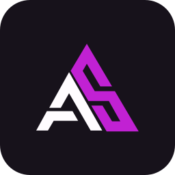

<div align="center">
  <p></p>
  <h1>Antonio Silva Brand</h1>
  <p>Identidade institucional, iconografia e recursos de marca do estúdio Antonio Silva.</p>
  <p>
    <a href="Manual%20de%20identidade%20visual.pdf"><strong>Explore o manual da marca »</strong></a>
    <br /><br />
    <a href="icons.html">Catálogo de ícones</a>
    · <a href="research.md">Pesquisa de referência</a>
    · <a href="react/README.md">Biblioteca React</a>
  </p>
</div>

<p align="center">
  
  
  
</p>

<details>
  <summary>Índice</summary>

- [Sobre o projeto](#sobre-o-projeto)
- [Tecnologias](#tecnologias)
- [Começando](#começando)
- [Uso](#uso)
- [Arquitetura](#arquitetura)
- [Qualidade](#qualidade)
- [Contribuindo](#contribuindo)
- [Licenças](#licenças)

</details>

## Sobre o projeto

Este repositório reúne os arquivos de identidade institucional da Antonio Silva.
O manual documenta o monograma AS, as assinaturas, a paleta, a tipografia e a voz da marca.
O catálogo inclui 100 ícones em 11 categorias, com uma descrição de uso em português por ícone.

### Estado dos materiais

- **Manual 0.3.0**. Identidade vigente. O lema permanece em avaliação.
- **Ícones 0.4.3**. Pack de 100 ícones com refinamentos de curvas e legibilidade nos símbolos revisados.
- **Fontes**. Space Grotesk para títulos e assinatura. IBM Plex Sans para leitura e interface.

## Tecnologias

| Tecnologia | Responsabilidade |
| --- | --- |
| SVG | Fontes vetoriais do monograma, das assinaturas e dos ícones |
| HTML e CSS | Manual editável, catálogo e tokens visuais |
| JSON | Manifesto dos ícones e tokens de marca |
| Python 3 | Geração dos componentes a partir dos SVGs |
| React 18 e 19 e TypeScript | Consumo dos componentes e declarações de tipos |

## Começando

Abra o [manual em PDF](Manual%20de%20identidade%20visual.pdf) para consulta. Para pesquisar e testar
tamanho, cor e opacidade dos ícones, abra `icons.html` em um navegador após obter os arquivos localmente.

### Gerando a biblioteca React

Com Node.js, npm e Python 3 disponíveis, rode na raiz deste repositório:

```bash
cd react
npm run build
npm pack
```

No projeto consumidor, instale o arquivo gerado:

```bash
npm install /caminho/para/-brand/react/antonio-silva-icons-0.4.3.tgz
```

## Uso

```tsx
import { UndoIcon } from "@antonio-silva/icons";

<button type="button" aria-label="Desfazer">
  <UndoIcon size={20} />
</button>
```

Consulte o [contrato de consumo](icons.md) para aplicar cor por plano, opacidade e nome acessível.

## Arquitetura

| Caminho | Conteúdo |
| --- | --- |
| `manual.html` e o PDF | Manual editável e versão para leitura |
| `assets/icons/` | 100 SVGs do catálogo |
| `assets/` | Monogramas, assinaturas, avatar e grid |
| `fonts/` | Arquivos TTF e licenças |
| `tokens/` | Cores, temas e escalas em CSS e JSON |
| `icons.json` e `icons.html` | Inventário e catálogo visual |
| `react/` | Gerador, contrato e configuração do pacote local |

## Qualidade

Os ícones usam uma prancheta de 24 × 24. Confira cada alteração no catálogo a 16, 24 e 32 px
sobre fundos claros e escuros. Compare símbolos que podem ser confundidos, como bloquear e desbloquear.
Regenere o pacote após alterar os SVGs e verifique se o manifesto e o catálogo correspondem aos arquivos.

## Contribuindo

Para alterar um ícone, atualize a geometria em `assets/icons/`, preserve seu identificador
e revise a prévia no catálogo. Registre mudanças de uso no manual ou no contrato conforme o impacto.

## Licenças

Space Grotesk e IBM Plex Sans são distribuídas sob a SIL Open Font License.
Consulte os arquivos [Space Grotesk OFL](fonts/space-OFL.txt) e [IBM Plex Sans OFL](fonts/plex-OFL.txt).
Essas licenças se aplicam aos arquivos de fonte.
